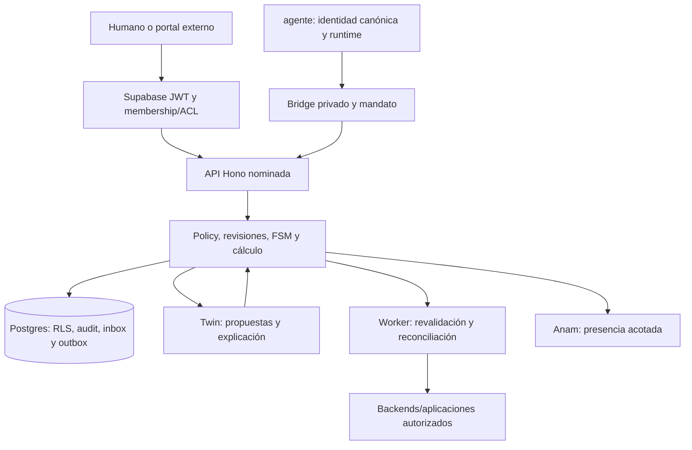

# Arquitectura y autoridad

Propuesta TypeScript/Hono/pnpm con contratos runtime, core determinista, Postgres/Supabase, workers/outbox y adaptadores. Procesos especializados aislados cuando el dominio lo requiera; no importar servidor padre entero como librería ni duplicar su OS empresarial. No implementado.

## Fronteras de confianza

OperadorP, tenantsA/B, proyectos/expedientes/recursos y principales son niveles distintos. Un registro de persona/cliente/alumno no es User ni membership. Compartir organización/marca/cohorte/nombre no comparte permiso. El operador y su agente actúan sobre targetTenant solo por delegación explícita; guardar Actor.tenantId de origen y scope de datos objetivo separados. No modificar Actor para simular pertenencia del cliente.

Cliente externo usa portal propio con idéntico Supabase/PEP y twin del padre. Puede contratar este servicio sin los otros ocho; módulos locales aprobados pueden cubrir funciones comunes. Un hermano ausente no justifica inventar saldo, revisión, dictamen, permiso profesional o dato. La duplicación funcional está permitida, con responsable único de efecto/campo por encargo.

## Dominio y autoridad

El CRM elegido o el core local custodia cada campo por AuthorityMap; precio/stock/plazo proceden de fuentes verificadas; firma y caja confirman hechos externos, no el chat.

Objetos: `Account Contact ChannelIdentity LeadCandidate AcceptedLead Opportunity PipelineStage Activity Product PriceBook QuoteRevision DiscountMandate MeetingProposal FollowUp Opposition ForecastSnapshot HandoffReceipt`. Estados propuestos de dominio: `discovered, accepted, qualified, proposal_draft, in_review, approved_to_send, sent, negotiating, won_unverified, won_verified, lost, opted_out, reconciliation_required`. No son enums ya existentes en el padre. Mapear por EntityLink y registrar quién custodia original, proyección, revisión humana y prueba de resultado. Una conclusión aprobada puede volverse stale al cambiar fuente; conservar el snapshot aceptado y crear nueva revisión.

QuoteTotals: sumar cantidad×precio unitario con Decimal, descuentos según ámbito/orden explícito, moneda/redondeo y tax mapping aprobado por fuentes; no inferir impuestos. Congelar priceBook/version/stock/delivery assertions. Forecast es un snapshot de escenarios, no ingreso cobrado ni garantía.

## Módulos y datos

API/BFF con DTOs y scopes; servicios de negocio para fases9–32; repositorio tenant-scoped de objetos/versiones; policy/approval; adaptadores de datos; gateway de modelos; jobs/inbox/outbox/receipts; reports; presencia; SDK servidor. Tablas propuestas: agreements/work_orders, principals/bindings, domain_objects/revisions, source_documents/evidence_refs, external_links, provider_connections/capability_reports, proposals/approvals, intents/attempts/receipts, jobs/leases/cursors/conflicts, budgets/reservations, inbox/outbox/audit y snapshots. FKs/índices compuestos por tenant y recurso según cardinalidad. No API keys o JWT persistidos como datos de dominio.

Transacción local confirma estado/version/audit/idempotency/outbox; HTTP remoto no comparte esa transacción. Leases/fencing protegen coherencia local, no exactly-once remoto. Cursor avanza tras commit. Export/reindexación/restore conservan permisos, retención y estado sin reenviar efectos. Observabilidad no expone payloads de clientes.

## Modelo y revisión

El gateway solo permite modelos/configuraciones aprobados por tarea, idioma, región/retención y coste. El contexto mínimo se autoriza antes del retrieval y antes de responder. LLM no recibe credenciales, lista de tenants o tool genérica. Revisor LLM puede encontrar problemas; no puede certificar, atribuir condición profesional, ampliar presupuesto ni aprobar su propio efecto. La explicación cita hechos/fuentes y distingue inferencia.

Rota empresarial del padre; este repo expone trabajo/estado/eventos y timers técnicos pertinentes, sin segundo scheduler de empleados. Una tarea ofrecida necesita ACK real; un briefing informa acciones con evidencia, no simula actividad. Instalación/wiring en padre fuera de este encargo.
